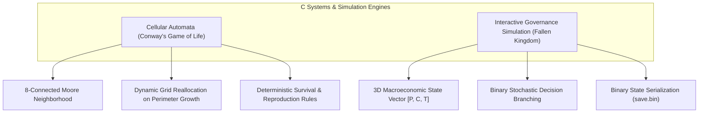

# C Algorithms & Interactive Simulation Engines

A dedicated systems programming monorepo in ANSI C, consolidating low-level cellular automata with dynamic perimeter grid expansion and state-machine driven terminal strategy simulations.

---

## Repository Structure

```
c-algorithms-and-games/
├── projects/
│   └── SimpleProjects/            # Low-level C simulations & game state engines
│       ├── FallingKingdom.c       # Interactive kingdom state-machine strategy game in C
│       ├── gameOfLife.c           # Conway's Game of Life with dynamic perimeter grid expansion in C
│       └── README.md              # Detailed documentation for C systems
│
├── .gitignore                     # Centralized build and binary exclusion rules
└── README.md                      # Monorepo technical documentation
```

---

## Architectural Systems Overview



---

## Technical Foundations & Formulations

### 1. Cellular Automata with Dynamic Perimeter Expansion (`gameOfLife.c`)
Implements John Conway's standard 2D zero-player automaton using an 8-connected Moore neighborhood kernel:
$$k(i, j) = \sum_{di=-1}^1 \sum_{dj=-1}^1 S_t(i+di, j+dj) - S_t(i, j)$$

Deterministic state transitions follow:
$$S_{t+1}(i, j) = \begin{cases} 
1 & \text{if } S_t(i, j) = 1 \land k(i, j) \in \{2, 3\} \\
1 & \text{if } S_t(i, j) = 0 \land k(i, j) = 3 \\
0 & \text{otherwise}
\end{cases}$$

**Dynamic Perimeter Expansion:** Unlike traditional static grid implementations bounded by hard reflection or toroidal wrapping, the engine actively inspects coordinate perimeters each generation. When living cells approach the allocated boundary, the coordinate space dynamically reallocates, expanding outward (up to $2\times$ initial dimension, $2N+1$) to prevent boundary clipping.

### 2. Fallen Kingdom Governance Simulation (`FallingKingdom.c`)
Models sovereign resource management using a normalized 3-dimensional macroeconomic state vector bounded within $[0, 100]$:
$$\mathbf{S}_t = \begin{pmatrix} P_t \\ C_t \\ T_t \end{pmatrix} = \begin{pmatrix} \text{Citizenry / Population Well-being} \\ \text{Court / Aristocratic Loyalty} \\ \text{Treasury / Financial Solvency} \end{pmatrix}$$

- **Pointer-Based Linked List Engine:** Manages a dynamic singly linked list of dilemmas ingested from `CHOICES.txt` and scenario files. Each dilemma tracks occurrence quotas (`chance = 3`), dynamically pruning exhausted scenarios and regenerating when the pool is depleted.
- **Decision Branching & Differential Updates:** Binary options apply discrete delta vectors $\mathbf{\Delta}_k = (\Delta P_k, \Delta C_k, \Delta T_k)^\top$:
  $$\mathbf{S}_{t+1} = \operatorname{clip}_{[0, 100]}(\mathbf{S}_t + \mathbf{\Delta}_k)$$
- **Terminal Defeat Conditions:** The reign collapses if any parameter drops to zero ($P \le 0 \lor C \le 0 \lor T \le 0$) or if the average falls below critical thresholds ($\frac{P+C+T}{3} < 10$).
- **Binary State Serialization:** Includes low-level file I/O operations serializing binary game state (`save.bin`) using C `struct`s, distinguishing between mid-game voluntary exits (`-1`) and post-defeat resets.
- **Top 10 Leaderboard:** Tracks and ranks sovereigns based on aggregate survival metrics.

---

## Build & Run Guide

Compile using any standard C compiler (`gcc`, `clang`):

```bash
cd projects/SimpleProjects

# Compile Conway's Game of Life
gcc -O2 gameOfLife.c -o gameOfLife
./gameOfLife

# Compile Fallen Kingdom
gcc -O2 FallingKingdom.c -o FallingKingdom
./FallingKingdom
```

---

## Provenance & Git History

Full commit history from the original source repository has been preserved using `git subtree`:
- `projects/SimpleProjects` originating from [SimpleProjects](https://github.com/MahdiTheGreat/SimpleProjects)
