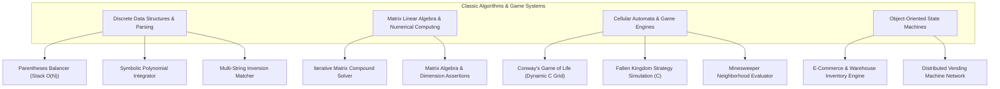

# Classic Algorithms and Interactive Game Systems

A consolidated monorepo uniting foundational algorithms, low-level cellular automata and game engines in C, symbolic calculus and string parsing engines, and object-oriented transaction state machines in Java.

---

## Repository Structure

```
classic-algorithms-and-games/
├── projects/
│   ├── JavaExercises/             # Algorithmic suite & object-oriented state machines
│   │   ├── Ecommerce.java         # Multi-tier e-commerce and warehouse inventory lifecycle
│   │   ├── FoodVendingMachine.java# Multi-unit automated retail transaction controller
│   │   ├── integral.java          # Symbolic polynomial integration and expression canonicalizer
│   │   ├── IterativeMatrixCalculator.java # Iterative compound matrix linear algebra engine
│   │   ├── minesweeper.java       # Discrete grid 8-neighbor mine proximity scanner
│   │   ├── ParenthesesBalancer.java # Stack-based syntax validation and prefix extractor
│   │   ├── substring.java         # Multi-string common and inverted pattern matcher
│   │   └── README.md              # Detailed documentation for Java algorithms
│   │
│   └── SimpleProjects/            # Cellular automata, strategy engines & numerical solvers
│       ├── FallingKingdom.c       # Interactive kingdom state-machine strategy game in C
│       ├── gameOfLife.c           # Conway's Game of Life with dynamic perimeter grid expansion in C
│       ├── InternetShop.java      # Retail inventory, customer cart & accounting engine
│       ├── matrixCalculator.java  # Matrix arithmetic engine with dimension compatibility checking
│       ├── mineGame.java          # 2D proximity matrix generator for discrete mine detection
│       └── README.md              # Detailed documentation for game engines and C systems
│
├── .gitignore                     # Centralized build and binary exclusion rules
└── README.md                      # Monorepo technical documentation
```

---

## Architectural Pillars



---

## Technical Pillars & Mathematical Formulations

### 1. Discrete Data Structures & Parsing Algorithms
- **Stack-Based Syntax Parsing:** Evaluates parenthetical expressions using linear-time stack push/pop invariant tracking to isolate the maximal contiguous prefix satisfying first-in, last-out nesting guarantees.
- **Symbolic Calculus & Canonical Simplification:**
  Accepts arbitrary polynomial expressions and analytically computes indefinite integrals:
  $$\int P(x) \, dx = \int \left( \sum_{i=1}^m a_i x^{k_i} \right) dx = \sum_{i=1}^m \left( \frac{a_i}{k_i + 1} \right) x^{k_i + 1}$$
  The engine canonicalizes terms by aggregating like powers, sorting terms in strictly descending order of exponent, rounding decimal coefficients, and stripping redundant terms.
- **Inverted Substring Matching:** Identifies the longest contiguous sequence $S$ common across a set of input strings, invariant under string reversal:
  $$S \subseteq \sigma \quad \lor \quad S^{\mathcal{R}} \subseteq \sigma \quad \forall \sigma \in \Sigma$$

### 2. Matrix Linear Algebra & Numerical Computing
- **Compound Matrix Recurrence:**
  Evaluates successive matrix transformations under addition, subtraction, or matrix multiplication across $n$ compounding cycles:
  $$R_k = f(R_{k-1}, M_2) \quad \text{with } R_0 = M_1, \quad k \in \{1, \dots, n\}$$
  Inner-dimension compatibility ($\operatorname{cols}(A) = \operatorname{rows}(B)$) is asserted prior to operation dispatch to guarantee numerical validity.

### 3. Cellular Automata & Interactive Game Engines
- **Conway's Game of Life with Dynamic Grid Expansion:**
  Implements the standard 2D zero-player automaton using an 8-connected Moore neighborhood:
  $$k(i, j) = \sum_{di=-1}^1 \sum_{dj=-1}^1 S_t(i+di, j+dj) - S_t(i, j)$$
  When active configurations approach perimeter boundaries, the system automatically allocates memory to expand the coordinate grid dynamically, eliminating hard-boundary reflections.
- **Fallen Kingdom Decision Strategy Engine:**
  Models sovereign governance using a 3-dimensional bounded macroeconomic state vector:
  $$\mathbf{S}_t = \begin{pmatrix} P_t \\ C_t \\ T_t \end{pmatrix} \in [0, 100]^3 \quad (\text{Population, Court, Treasury})$$
  Binary decision branching applies differential vector updates $\mathbf{S}_{t+1} = \operatorname{clip}_{[0, 100]}(\mathbf{S}_t + \mathbf{\Delta}_k)$ alongside binary state serialization to support persistent session recovery.

### 4. Object-Oriented State Machines & Retail Systems
- **E-Commerce & Warehouse Systems:** Full transactional event-loop dispatcher managing multi-tier dependencies between customer wallets, warehouse volumetric quotas, product SKU inventories, dynamic discount coupons, and cumulative revenue balance sheets.
- **Vending Machine Network:** Simulates a distributed network of automated retail units, tracking SKU mapping, restock streams, customer purchase events, and unit-level financial telemetry.

---

## Build & Run Guide

### C Systems (GCC / Clang)

```bash
# Navigate to C implementations
cd projects/SimpleProjects

# Compile and launch Conway's Game of Life
gcc -O2 gameOfLife.c -o gameOfLife
./gameOfLife

# Compile and launch Fallen Kingdom
gcc -O2 FallingKingdom.c -o FallingKingdom
./FallingKingdom
```

### Java Systems (OpenJDK 11+)

```bash
# Navigate to Java implementations
cd projects/JavaExercises

# Run Symbolic Integrator
javac integral.java
java com.company.Main

# Run Stack Parentheses Balancer
javac ParenthesesBalancer.java
java ParenthesesBalancer

# Run Iterative Matrix Calculator
javac IterativeMatrixCalculator.java
java IterativeMatrixCalculator

# Run E-Commerce Engine
javac Ecommerce.java
java Ecommerce
```

---

## Commit History & Provenance

Full commit histories from the original source repositories have been preserved using `git subtree`:
- `projects/JavaExercises` originating from [JavaExercises](https://github.com/MahdiTheGreat/JavaExercises)
- `projects/SimpleProjects` originating from [SimpleProjects](https://github.com/MahdiTheGreat/SimpleProjects)
